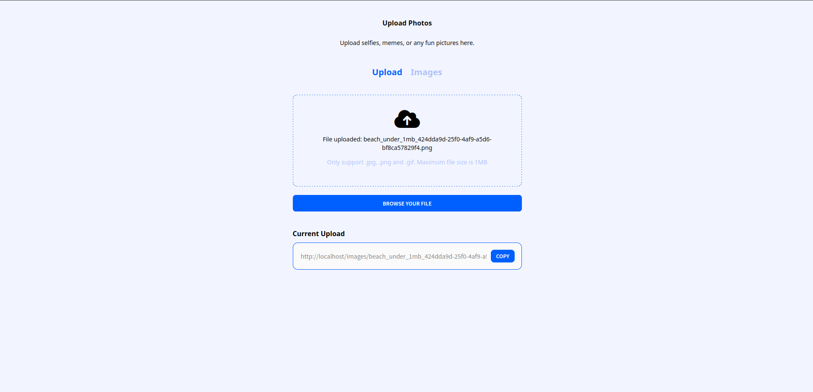
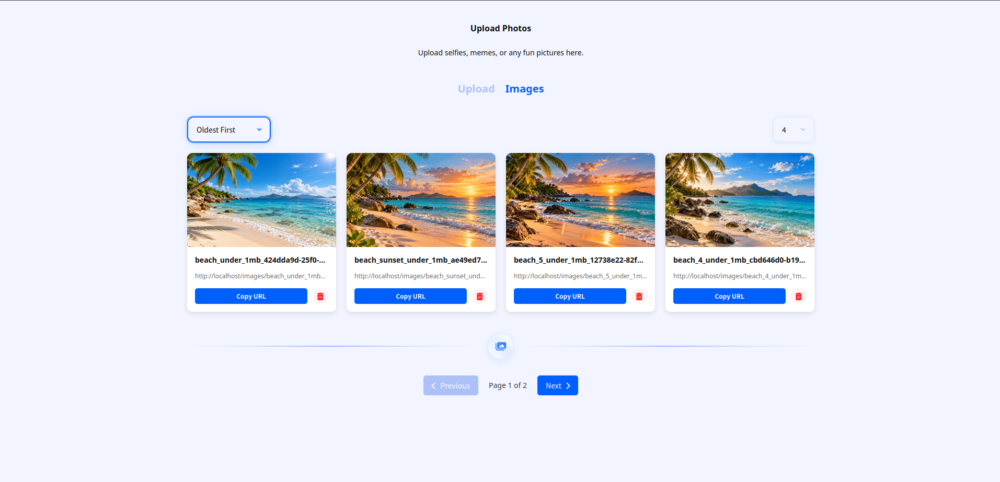
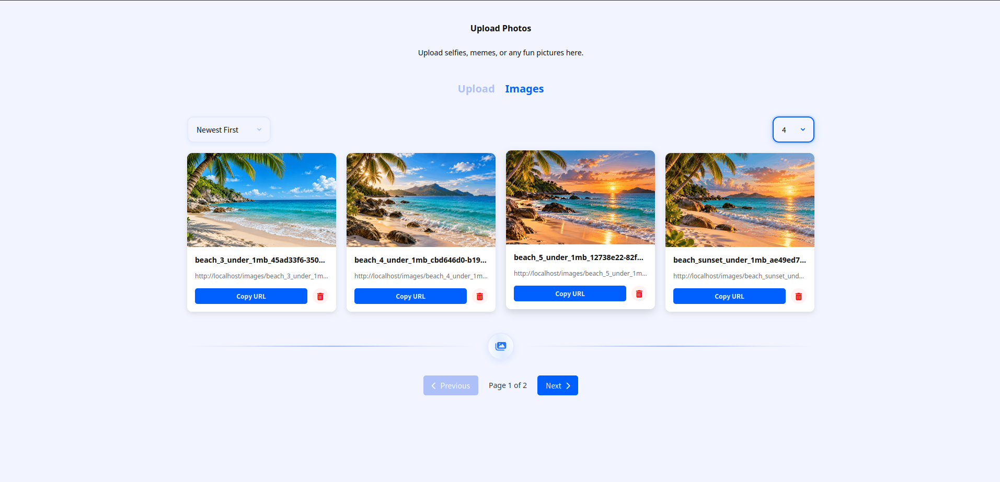
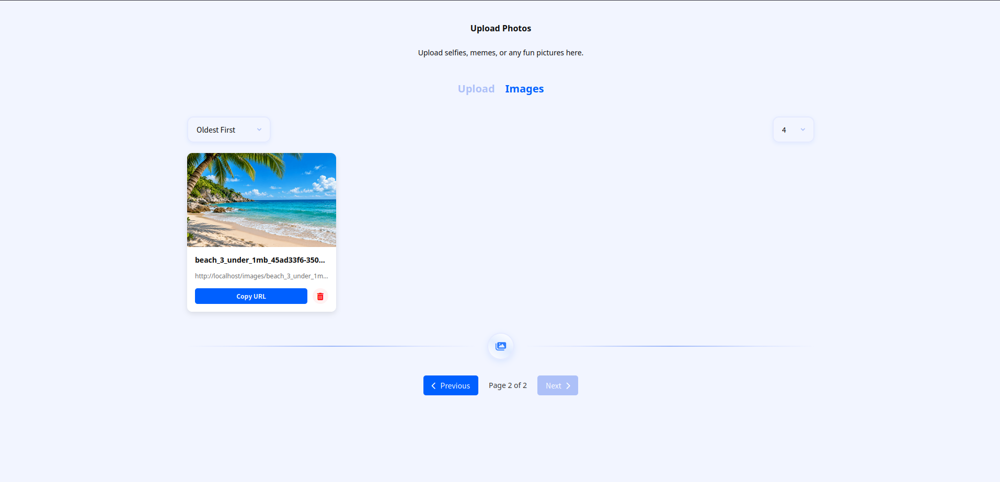
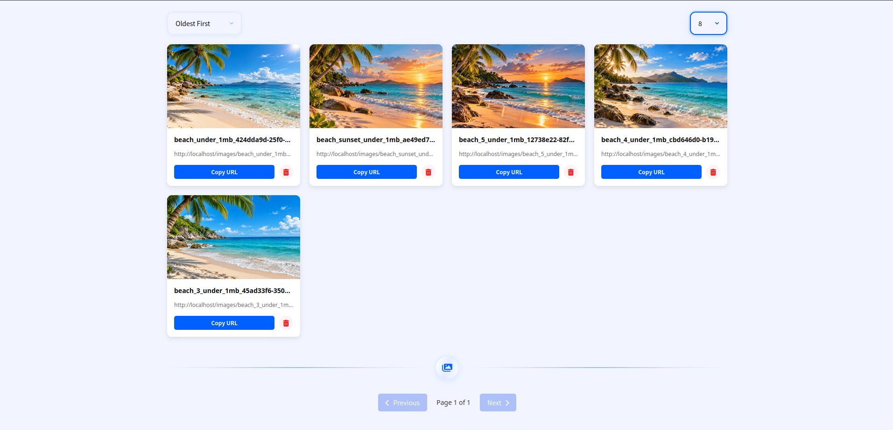

# 📸 Upload Server

Upload Server is a web application for uploading, storing, viewing, and deleting images through a user-friendly web interface.

The project consists of a frontend built with HTML, CSS, and JavaScript, and a backend developed in Python using FastAPI.

PostgreSQL is used to store image information, while PgBouncer manages database connections.

Nginx serves the frontend and static files and proxies requests to the backend.

All main services are launched using Docker Compose.

---

## 🛠️ Technologies

| Technology | Purpose |
|------------|---------|
| HTML5 | Web page structure |
| CSS3 | Interface styling |
| JavaScript | Frontend interactivity |
| Python | Backend programming language |
| FastAPI | Application backend |
| Uvicorn | ASGI server |
| PostgreSQL | Database |
| PgBouncer | PostgreSQL connection pooling |
| Nginx | Web server and reverse proxy |
| Docker | Containerization |
| Docker Compose | Service management |
| Poetry | Python dependency management |

---

## ✨ Features

- Uploading images through the web interface.
- Support for JPG, JPEG, PNG, and GIF formats.
- Maximum upload file size of 1 MB.
- Storing images in a local directory.
- Storing file information in PostgreSQL.
- Viewing all uploaded images in a gallery.
- Copying image URLs.
- Deleting uploaded photos.
- Sorting images by upload date.
- Image list pagination.
- Configuring the number of images per page.
- Randomly displaying an image on the home page.
- A separate page for uploading photos.
- Running all services using Docker Compose.

---

## 📸 Application Demonstration

Below are screenshots of the Upload Server web interface demonstrating the application's main features.

### 1. Image Upload

In the **Upload** tab, users can upload their own images.

Supported formats are JPG, PNG, and GIF. The maximum file size is 1 MB.

After a successful upload, the file name and its URL are displayed. The URL can be copied using the **Copy** button.

<p align="center">
    
</p>

### 2. Image Gallery

The **Images** tab displays all uploaded images.

Each image provides:

- Image preview.
- File name.
- Image URL.
- **Copy URL** button for copying the link.
- Button for deleting the image.

<p align="center">
    
</p>

### 3. Image Sorting

The gallery supports sorting images by upload date.

Two sorting modes are available:

- **Newest First** — displays the newest images first.
- **Oldest First** — displays the oldest images first.

After changing the sorting mode, the image order is automatically updated.

<p align="center">
    
</p>

### 4. Pagination

Pagination is implemented to make browsing large numbers of images more convenient.

Users can navigate between pages using the following buttons:

- **Previous** — previous page.
- **Next** — next page.

The current page and total number of pages are also displayed.

<p align="center">
    
</p>

### 5. Configuring the Number of Images

Users can select how many images are displayed on a single page.

For example:

- 4 images.
- 8 images.

After changing the value, the gallery is automatically updated, and the total number of pages is recalculated.

<p align="center">
    
</p>

---

## 📁 Project Structure

```text
WebSite_UploadImg/
│
├── images/
├── init-sql/
├── logs/
│
├── screenshots/
│   ├── Screenshot1.png
│   ├── Screenshot2.png
│   ├── Screenshot3.png
│   ├── Screenshot4.png
│   └── Screenshot5.png
│
├── services/
│   │
│   ├── backend/
│   │   ├── src/
│   │   │   ├── db/
│   │   │   │   ├── __init__.py
│   │   │   │   ├── dependencies.py
│   │   │   │   ├── dto.py
│   │   │   │   ├── repositories.py
│   │   │   │   └── session.py
│   │   │   │
│   │   │   ├── dto/
│   │   │   │   ├── __init__.py
│   │   │   │   ├── file.py
│   │   │   │   └── pagination.py
│   │   │   │
│   │   │   ├── exceptions/
│   │   │   │   ├── __init__.py
│   │   │   │   ├── api_errors.py
│   │   │   │   └── repository_errors.py
│   │   │   │
│   │   │   ├── handlers/
│   │   │   │   ├── __init__.py
│   │   │   │   ├── dependencies.py
│   │   │   │   ├── files.py
│   │   │   │   └── upload.py
│   │   │   │
│   │   │   ├── interfaces/
│   │   │   │   ├── __init__.py
│   │   │   │   ├── handlers.py
│   │   │   │   ├── pagination.py
│   │   │   │   ├── protocols.py
│   │   │   │   └── repositories.py
│   │   │   │
│   │   │   ├── settings/
│   │   │   │   ├── config.py
│   │   │   │   └── logging_config.py
│   │   │   │
│   │   │   ├── app.py
│   │   │   └── run.py
│   │   │
│   │   ├── .env
│   │   ├── .env.sample
│   │   ├── Dockerfile
│   │   ├── poetry.lock
│   │   └── pyproject.toml
│   │
│   ├── frontend/
│   │   ├── assets/
│   │   │   └── images/
│   │   │       ├── bird.png
│   │   │       ├── black_dog.png
│   │   │       ├── cat.png
│   │   │       ├── meditating_dog.png
│   │   │       └── rose-dog.png
│   │   │
│   │   ├── css/
│   │   │   ├── reset.css
│   │   │   ├── style.css
│   │   │   └── upload.css
│   │   │
│   │   ├── js/
│   │   │   ├── random-hero.js
│   │   │   ├── tabs.js
│   │   │   └── upload.js
│   │   │
│   │   ├── index.html
│   │   └── upload.html
│   │
│   ├── nginx/
│   │   └── nginx.conf
│   │
│   └── pgbouncer/
│       ├── commands/
│       ├── .env
│       ├── .env.sample
│       └── Dockerfile
│
├── .dockerignore
├── .gitignore
├── docker-compose.yml
├── README.md
└── requirements.txt
```

> **Important:** Images for the home page must be added manually if they are missing after cloning the repository.
>
> The `.env` files must be created from the `.env.sample` templates and configured before running the application.

---

## 🚀 Installation and Setup

### 1. Clone the Repository

Clone the repository:

```bash
git clone https://github.com/Maxutka74/WebSite_UploadImg.git
```

Navigate to the project directory:

```bash
cd WebSite_UploadImg
```

### 2. Configure Frontend Images

Before running the application, you need to add the images used on the home page.

Create the directory:

```bash
mkdir -p services/frontend/assets/images
```

By default, `index.html` uses five images:

```text
bird.png
cat.png
black_dog.png
rose-dog.png
meditating_dog.png
```

Add these files to the directory:

```text
services/frontend/assets/images/
```

After adding the images, the directory structure should look like this:

```text
services/frontend/
└── assets/
    └── images/
        ├── bird.png
        ├── cat.png
        ├── black_dog.png
        ├── rose-dog.png
        └── meditating_dog.png
```

**Images are not created automatically. You must add them manually.**

#### Using Your Own Photos

You can use any of your own images.

There are two ways to add them.

**Method 1. Keep the Default File Names**

Add your own photos and rename them according to the file names used in `index.html`:

```text
bird.png
cat.png
black_dog.png
rose-dog.png
meditating_dog.png
```

In this case, you do not need to modify the HTML.

**Method 2. Use Custom File Names**

If you want to use different file names, open:

```text
services/frontend/index.html
```

Find the following block:

```html
<div class="hero">
    <div class="hero__image">
        
    </div>

    <div class="hero__image">
        
    </div>

    <div class="hero__image">
        
    </div>

    <div class="hero__image">
        
    </div>

    <div class="hero__image">
        
    </div>
</div>
```

Replace the `src` values with paths to your own images.

For example:

```html
<div class="hero__image">
    
</div>
```

The `my-photo.png` file must be located at:

```text
services/frontend/assets/images/my-photo.png
```

You can also add new `hero__image` blocks or remove unnecessary ones.

JavaScript will automatically select a random image from the available blocks.

> If the file name or the path in `src` is incorrect, the browser will not be able to load the image.

### 3. Configure Environment Variables

The project contains two `.env.sample` files with templates for the required environment variables.

Create the `.env` files from these templates:

```bash
cp services/backend/.env.sample services/backend/.env
cp services/pgbouncer/.env.sample services/pgbouncer/.env
```

Then open:

```text
services/backend/.env
services/pgbouncer/.env
```

Fill in the required values according to the project configuration.

In particular, you need to configure:

- PostgreSQL connection settings.
- Database credentials.
- PgBouncer settings.
- Other variables used by the backend.

The exact variable names can be found in the corresponding `.env.sample` files.

**Do not commit `.env` files containing real passwords or sensitive information to Git.**

### 4. Run Docker Compose

To run the project, you need to install:

- Docker.
- Docker Compose.

Make sure Docker is running.

Execute the following command in the project's root directory:

```bash
docker compose up --build -d
```

Docker Compose will start:

- FastAPI.
- Nginx.
- PostgreSQL.
- PgBouncer.

Check the container status:

```bash
docker compose ps
```

View logs:

```bash
docker compose logs -f
```

Stop the containers:

```bash
docker compose down
```

### 5. Open the Website

After a successful startup, open:

**http://localhost**

The home page will display a random image from the directory:

```text
services/frontend/assets/images/
```

Photo upload page:

**http://localhost/upload.html**

---

## 🎨 Frontend

The frontend is built using HTML, CSS, and JavaScript.

### Main Files

| File | Purpose |
|------|---------|
| `index.html` | Home page |
| `upload.html` | Photo upload page |
| `css/style.css` | Home page styles |
| `css/upload.css` | Upload page styles |
| `css/reset.css` | Resetting default browser styles |
| `js/random-hero.js` | Random image selection |
| `js/tabs.js` | Tab switching |
| `js/upload.js` | Image upload logic |
| `assets/images/` | Static images |

### Random Image Display

JavaScript is used on the home page to randomly select one of the images.

First, all image blocks are selected:

```javascript
const allImgBlocks = document.querySelectorAll('.hero__image');
```

Then a random index is generated:

```javascript
const randomIndex = Math.floor(Math.random() * allImgBlocks.length);
```

The selected block receives a class:

```javascript
const randomBlock = allImgBlocks[randomIndex];

randomBlock.classList.add('is-visible');
```

By default, all blocks are hidden:

```css
.hero__image {
    display: none;
}
```

The selected image is displayed using:

```css
.hero__image.is-visible {
    display: block;
}
```

Thus, each time the page is reloaded, one of the available images is randomly selected.

### Upload Page

The `upload.html` page is designed for uploading photos.

Main files:

```text
services/frontend/upload.html
services/frontend/css/upload.css
services/frontend/js/upload.js
services/frontend/js/tabs.js
```

`upload.css` is responsible for page styling, `upload.js` handles the upload logic, and `tabs.js` manages tab switching.

---

## ⚙️ Backend

The backend is developed in Python using FastAPI.

### Main Components

| File | Purpose |
|------|---------|
| `src/app.py` | Main FastAPI application |
| `src/run.py` | Application startup module |
| `src/db/dependencies.py` | Database dependencies |
| `src/db/dto.py` | Image DTOs |
| `src/db/repositories.py` | PostgreSQL operations |
| `src/db/session.py` | Database session management |
| `src/dto/file.py` | File DTOs |
| `src/dto/pagination.py` | Pagination DTOs |
| `src/exceptions/api_errors.py` | Error handling |
| `src/exceptions/repository_errors.py` | Repository errors |
| `src/handlers/dependencies.py` | Handler dependencies |
| `src/handlers/files.py` | File processing |
| `src/handlers/upload.py` | Upload processing |
| `src/interfaces/` | Interfaces and protocols |
| `src/settings/config.py` | Application configuration |
| `src/settings/logging_config.py` | Logging configuration |

### Backend Configuration

The main settings are located in:

```text
services/backend/src/settings/config.py
```

They include:

- `IMAGE_DIR` — directory for storing files.
- `MAX_FILE_SIZE` — maximum uploaded file size.
- `SUPPORTED_FORMATS` — supported file formats.
- Database connection settings.

The following file is used to configure environment variables:

```text
services/backend/.env.sample
```

Python dependencies are managed using:

```text
services/backend/pyproject.toml
services/backend/poetry.lock
```

To change the maximum file size or supported formats, modify the corresponding configuration parameters.

---

## 🖼️ Image Storage

The project uses two separate directories.

### 1. Static Frontend Images

```text
services/frontend/assets/images/
```

These images are used to decorate the home page.

For example:

```text
services/frontend/assets/images/cat.png
```

Accessible through Nginx:

```text
http://localhost/assets/images/cat.png
```

### 2. User-Uploaded Images

```text
images/
```

This directory is used by the backend to store user-uploaded files.

In Docker Compose, it is mounted into the containers using volumes:

```yaml
volumes:
  - ./images:/usr/src/images
```

Nginx provides access to uploaded files through:

```nginx
location /images/ {
    alias /usr/src/images/;
}
```

Example URL:

```text
http://localhost/images/photo.png
```

> Static frontend images and user-uploaded files are stored separately.

---

## 🐳 Docker

Docker Compose is used to run the project.

### Services

| Service | Container | Purpose |
|---------|-----------|---------|
| `web` | `upload-server` | FastAPI |
| `nginx` | `upload-nginx` | Web server |
| `db` | `postgres-upload-server` | PostgreSQL |
| `pgbouncer` | `pgbouncer-upload-server` | Connection pooling |

### Ports

| Port | Service |
|------|---------|
| `80` | Nginx |
| `8000` | FastAPI |
| `5432` | PostgreSQL |
| `6432` | PgBouncer |

### Docker Volumes

The main directories mounted into the containers are:

```text
./services/frontend
./services/backend/src
./images
./logs
```

A separate Docker volume is used for PostgreSQL:

```text
postgres_upload_server_data
```

This allows database data to persist independently of the container lifecycle.

---

## 📝 Logging

Logging is configured in:

```text
services/backend/src/settings/logging_config.py
```

Logs are stored in the directory:

```text
logs/
```

To view Docker logs:

```bash
docker compose logs -f
```

To view logs for a specific service:

```bash
docker compose logs -f web
```

---

## ❗ Troubleshooting

### Images Are Not Displayed

Check whether the following directory exists:

```text
services/frontend/assets/images/
```

Make sure the file names match the paths in `index.html`.

For example:

```html

```

For this image, the file path must be:

```text
services/frontend/assets/images/cat.png
```

You can also check whether the file is accessible through your browser:

```text
http://localhost/assets/images/cat.png
```

### Docker Does Not Start

Check the container status:

```bash
docker compose ps
```

View the logs:

```bash
docker compose logs
```

Make sure the `.env` files have been created from `.env.sample` and contain the required environment variables.

### CSS Changes Are Not Displayed

Try forcing a page refresh:

```text
Ctrl + Shift + R
```

This allows the browser to load the latest CSS version without using the old cache.

---

## 📌 Before Running

Make sure the following steps have been completed:

1. Docker and Docker Compose are installed.
2. The repository has been successfully cloned.
3. The `services/frontend/assets/images/` directory has been created if it does not exist.
4. Custom images have been added, or the paths in `index.html` have been updated.
5. The `.env` files have been created from `.env.sample`.
6. The required environment variables have been configured.
7. The Docker Compose ports are available.
8. `docker compose up --build -d` has been executed.

After a successful startup, open:

**http://localhost**

---

## 📄 License

The project license is not specified.